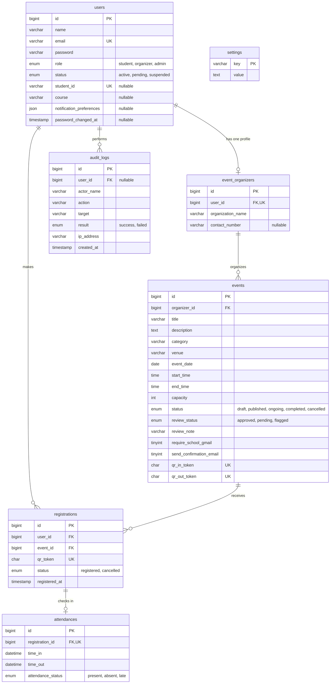

# Attendly database: decisions record (spec 4)

Reference SQL: `ERD_SQL_SCRIPT_SPEC4.sql`. It replaces spec 3.
The Laravel migrations must produce this same structure.

## ERD

Paste this into https://mermaid.live to see the diagram.

## What changed from spec 3

| Table | Change | Why |
|---|---|---|
| all | `id` and foreign keys are `BIGINT UNSIGNED` | Laravel's default key type |
| users | + `status` | Organizer approval queue and suspending accounts |
| users | + `student_id` (unique), `course` | My Account and attendance screens |
| users | + `notification_preferences` (JSON) | Notification switches for every role |
| users | + `password_changed_at` | "Last updated 32 days ago" |
| users | + `email_verified_at`, `remember_token` | Needed by Laravel's login system |
| event_organizers | `user_id` is now unique | One organization profile per organizer |
| events | `created_by` removed | Duplicated `organizer_id`. Admins do not create events for others |
| events | + `category` | Category chips and the event form |
| events | + `review_status`, `review_note` | Admin approval and flagging |
| events | + `require_school_gmail`, `send_confirmation_email` | Registration settings on the form |
| events | + `qr_in_token`, `qr_out_token` | Event QR codes that students scan |
| events | `capacity` is required (was optional) and must be 1 or more | The form always asks for it |
| events | time check (`end_time > start_time`) | Same rule as the form |
| registrations | `qr_token` is `CHAR(36)` | UUID tickets |
| registrations | index on `(event_id, status)` | Fast counts for organizers |
| attendances | check that `time_out` is not before `time_in` | Data integrity |
| settings | **new** | Admin Settings screen |
| audit_logs | **new** | Audit Log screen (append-only) |

## Decisions

| Design item | Decision |
|---|---|
| Waiting list | **Dropped for version 1.** Removed from the screens. `registrations.status` stays `registered` or `cancelled` |
| Organizer approval, suspension | One `users.status` column |
| Event moderation | `events.review_status`. Students only see `published` and `approved` events |
| Campus | No separate column. The venue text holds it, for example "Innovation Hall, Main Campus" |
| Event cover color | Worked out from the category. Not stored |
| Check-in methods | Both supported: event QR codes (`events.qr_in_token` / `qr_out_token`) and the student ticket (`registrations.qr_token`) |
| Event status | The `draft / published / ongoing / completed / cancelled` enum is kept, but the app also works out Live and Closed from the date and time, so a scheduler is optional |
| Photos and logos | Later |

## Calculated, not stored

| Shown on screen | How it is calculated |
|---|---|
| Registered count, seats | `COUNT` of `registrations` with status `registered` |
| Checked in, checked out, active now | Counts of `attendances` rows by `time_in` and `time_out` |
| Absent / no show | A registered student with no attendance row after the event ended |
| Show-up rate | Checked in divided by registered, for events that have started |
| Live / Upcoming / Closed | From `event_date`, `start_time`, `end_time` and `status` |
| Student dashboard stats | Counts over the student's registrations and attendances |
| Admin dashboard numbers | Counts over `users`, `events` and `audit_logs` |

## Rules the database enforces

- A student registers for an event only once (`unique_user_event`).
- One attendance row per registration (`unique_registration_attendance`).
- Event end time is after the start time, and capacity is at least 1.
- Check-out is never before check-in.
- Emails, student IDs and QR tokens are unique.
- Deleting an organizer who still has events is blocked (`ON DELETE RESTRICT`).

## Laravel's own tables

`personal_access_tokens`, `password_reset_tokens`, `sessions`, `cache` and `jobs` are created by Laravel's built-in migrations and are not part of this design.

## Import into MySQL Workbench

1. Run `ERD_SQL_SCRIPT_SPEC4.sql` once to check it, or skip this.
2. In Workbench: **File, Import, Reverse Engineer MySQL Create Script**, pick the file, then **Place imported objects on a diagram**.
3. Save as `ERD_MODEL_SPEC4.mwb`.
